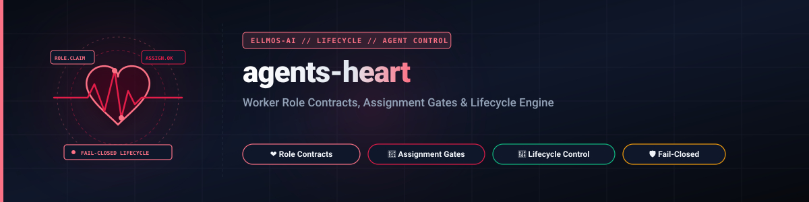

<p align="center">
  
</p>

# agents-heart

Provider-neutral control library (`modul:agents-heart`, v0.2.0) for agent role contract enforcement, assignment correlation, and worker profile lifecycle management.

## Overview

`agents-heart` acts as a fail-closed control layer between orchestrators and execution runtimes. It does not decide model selection or backend providers directly. Instead, it:
1. **Enforces role contracts (`authorize_role`)**: Verifies that an execution path holds required permissions (`task.claim`, `task.execute`) before work begins.
2. **Correlates assignments (`begin_assignment`, `finish_assignment`)**: Issues unique, immutable `Assignment` identifiers and emits matching start and end receipts (`assignment.started`, `assignment.ended`).
3. **Guards worker profile retirement (`delete_worker_profile`)**: Ensures worker inactivity, verifies all runs have reached terminal status (`phase == "terminal"`), archives records, and triggers safe removal.

## Installation

```bash
pip install -e .
```

## Usage

### Role Authorization

```python
from agents_heart import authorize_role, AssignmentDenied

# Validate contract permissions fail-closed
contract = authorize_role("task_worker", mode="full")
assert "task.claim" in contract.rights
assert "task.execute" in contract.rights

# Unauthorized roles raise AssignmentDenied
try:
    authorize_role("unknown_role", mode="full")
except AssignmentDenied as err:
    print(f"Denied: {err}")
```

### Assignment Correlation

```python
from agents_heart import begin_assignment, finish_assignment

events = []

# Record start receipt
assignment = begin_assignment(
    role_id="task_worker",
    mode="full",
    agent_instance_id="instance-42",
    backend_id="local_runner",
    model_id="gemini-flash",
    slot_id="worker_slot_01",
    task_id="TASK-1001",
    event_recorder=events.append,
)

# Perform actual execution...

# Record termination receipt
finish_assignment(
    assignment=assignment,
    status="completed",
    event_recorder=events.append,
    result="success",
)

assert len(events) == 2
assert events[0]["assignment_id"] == events[1]["assignment_id"]
```

### Worker Profile Deletion

```python
from agents_heart import delete_worker_profile

profile = {"id": "worker-alpha"}

success = delete_worker_profile(
    "worker-alpha",
    profile,
    assert_inactive=lambda p: None,
    terminal_records=lambda p: [{"id": "run-99", "phase": "terminal"}],
    archive=lambda pid, recs: print(f"Archived {len(recs)} runs for {pid}"),
    remove=lambda: True,
)
assert success is True
```

## Module Boundaries

- **Network:** None (`boundaries.network: "none"`)
- **Data:** User-local (`boundaries.data: "user-local"`)
- **Platforms:** Windows, macOS, Linux
- **Surfaces:** Python library (`entrypoints.library: "agents_heart"`)

## Testing

Run unit and contract tests via pytest:

```bash
pytest -v
```

## Documentation in German

A German companion guide is available at [README_de.md](README_de.md).

## License

MIT License. See [LICENSE](LICENSE) for details.
