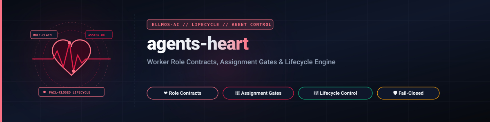

<p align="center">
  
</p>

# agents-heart (Deutsche Dokumentation)

Provider-neutrales Control-Modul (`modul:agents-heart`, v0.2.0) für Worker-Rollenverträge, Besetzungs-Autorisierung und Profil-Lebenszyklus.

## Überblick

`agents-heart` fungiert als fail-closed Steuerungsschicht zwischen Orchestratoren und Laufzeitumgebungen. Das Modul trifft keine eigenmächtigen Modell- oder Backend-Entscheidungen, sondern kapselt drei wesentliche Kontrollfunktionen:

1. **Rollen-Autorisierung (`authorize_role`)**: Prüft fail-closed, ob ein geplanter Ausführungspfad die erforderlichen Rechte (`task.claim`, `task.execute`) besitzt.
2. **Besetzungs-Korrelation (`begin_assignment`, `finish_assignment`)**: Vergibt unveränderliche `Assignment`-Identitäten und zeichnet korrelierbare Start- und Endbelege auf (`assignment.started`, `assignment.ended`).
3. **Sicheres Profil-Löschen (`delete_worker_profile`)**: Garantiert Inaktivität, verifiziert das Erreichen des Terminal-Status (`phase == "terminal"`) aller archivierten Läufe und führt die geordnete Bereinigung durch.

## Schnittstellen & Verwendung

### Rollen-Autorisierung

```python
from agents_heart import authorize_role, AssignmentDenied

# Rechtevertrag vor Ausführung prüfen
contract = authorize_role("task_worker", mode="full")
assert "task.claim" in contract.rights
assert "task.execute" in contract.rights

# Nicht autorisierte Rollen lösen AssignmentDenied aus
try:
    authorize_role("unbekannte_rolle", mode="full")
except AssignmentDenied as fehler:
    print(f"Abgelehnt: {fehler}")
```

### Besetzungs-Nachweise

```python
from agents_heart import begin_assignment, finish_assignment

ereignisse = []

# Startnachweis aufzeichnen
besetzung = begin_assignment(
    role_id="task_worker",
    mode="full",
    agent_instance_id="instanz-42",
    backend_id="lokaler_executor",
    model_id="gemini-flash",
    slot_id="worker_slot_01",
    task_id="TASK-1001",
    event_recorder=ereignisse.append,
)

# ... Task-Durchführung ...

# Endnachweis aufzeichnen
finish_assignment(
    assignment=besetzung,
    status="completed",
    event_recorder=ereignisse.append,
    result="erfolgreich",
)

assert len(ereignisse) == 2
assert ereignisse[0]["assignment_id"] == ereignisse[1]["assignment_id"]
```

### Sichere Worker-Profilbereinigung

```python
from agents_heart import delete_worker_profile

profil = {"id": "worker-alpha"}

erfolg = delete_worker_profile(
    "worker-alpha",
    profil,
    assert_inactive=lambda p: None,
    terminal_records=lambda p: [{"id": "lauf-99", "phase": "terminal"}],
    archive=lambda pid, belege: print(f"{len(belege)} Läufe für {pid} archiviert"),
    remove=lambda: True,
)
assert erfolg is True
```

## Modulgrenzen

- **Netzwerk:** Keine Netzwerkzugriffe (`boundaries.network: "none"`).
- **Daten:** Benutzerlokal (`boundaries.data: "user-local"`).
- **Plattformen:** Windows, macOS, Linux.
- **Oberfläche:** Python-Bibliothek (`entrypoints.library: "agents_heart"`).

## Lizenz

MIT-Lizenz. Siehe [LICENSE](LICENSE).
